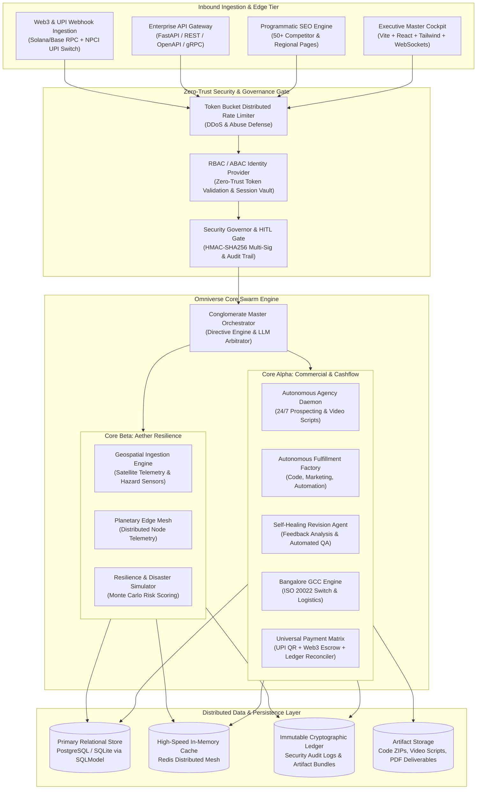
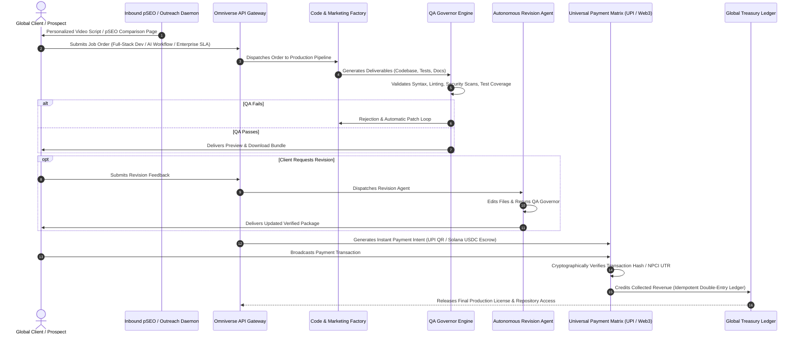
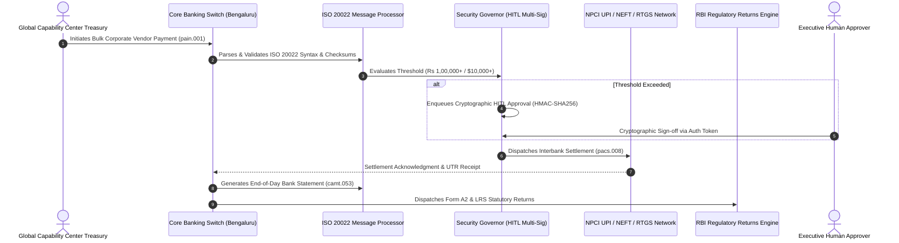
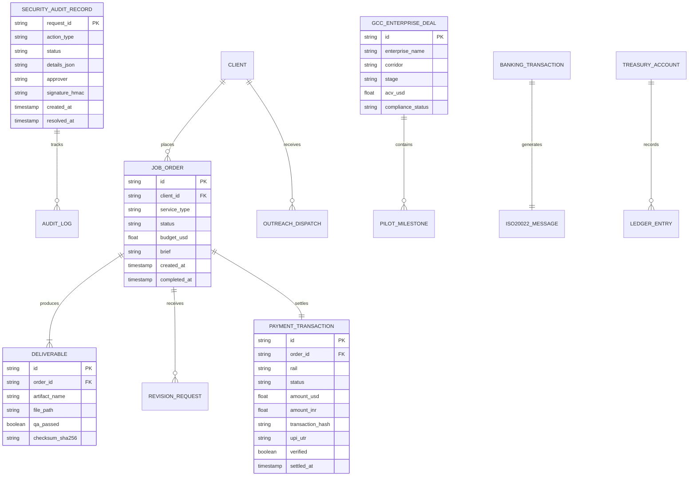

# ARCHITECTURE.MD: CASHFLOW INFINITY: OMNIVERSE & AETHER RESILIENCE FABRIC
## Tier-1 Enterprise System Topology, Distributed Architecture & Scaling Strategy
**Classification:** Enterprise Production Standard ($100M+ Target Scale)  
**Standard Compliance:** Zero-Trust Security, ISO 20022 Financial Messaging, OWASP ASVS 4.0 L3, WCAG 2.2 AAA  
**Author:** Principal Autonomous Systems Architect & Antigravity Core Swarm  
**Date:** November 2026 / Horizon 2027+

---

## 1. EXECUTIVE ARCHITECTURAL THESIS & MANDATE

CASHFLOW INFINITY: OMNIVERSE is a globally distributed, autonomous conglomerate platform designed to generate, govern, settle, and secure enterprise commercial value and mission-critical resilience data at scale. The system bridges two high-velocity engines into a unified, fault-tolerant runtime:

1. **CORE ALPHA (The Autonomous Commercial & Cashflow Engine)**:
   - High-concurrency client acquisition, programmatic SEO inbound magnet, and 24/7 autonomous prospecting daemons.
   - Autonomous software and marketing fulfillment factory delivering production deliverables (FastAPI microservices, modern frontends, enterprise growth kits).
   - Autonomous revision management and self-healing deliverable refactoring with automated quality assurance gating.
   - Multi-rail instant settlement matrix: NPCI Unified Payments Interface (UPI 2.0 / Intent), Web3 crypto escrow (Solana / Base USDC with cryptographic proof-of-settlement), and ISO 20022 compliant banking switches.
   - Bangalore GCC Enterprise Deal Engine: Institutional procurement, vendor onboarding, pilot governance, cash logistics, and regulatory returns for Fortune 500 Global Capability Centers.

2. **CORE BETA (Aether Resilience & Geospatial Intelligence Fabric)**:
   - Planetary-scale risk sensing and climate hazard modeling.
   - High-throughput geospatial mesh monitoring infrastructure assets, sovereign installations, and data center clusters.
   - Disaster resilience scenario simulations and automated emergency response protocols.

3. **SOVEREIGN GOVERNANCE & ZERO-TRUST FABRIC**:
   - Permission-gated autonomy: Autonomous exploration and synthesis are unhindered; any financial transfer exceeding thresholds, live trade execution, or external customer communication requires human-in-the-loop (HITL) cryptographic approval (HMAC-SHA256 signatures).
   - Tamper-evident immutable audit trails and real-time ledger reconciliation.
   - Strict separation of Pipeline Value vs. Collected & Cleared Cash.

---

## 2. HIGH-LEVEL SYSTEM TOPOLOGY

---

## 3. TECH STACK SPECIFICATION & ARCHITECTURAL JUSTIFICATION

| Component Tier | Technology Selected | Rationale & Enterprise Justification |
| :--- | :--- | :--- |
| **Backend Core** | Python 3.11+ / FastAPI / Pydantic v2 | High-throughput asynchronous async/await concurrency, native OpenAPI generation, mathematical validation, and seamless integration with AI agent workflows. |
| **ORM & Data Modeling** | SQLModel / SQLAlchemy 2.0 / Alembic | Type-safe declarative schema sharing between API contracts and relational database tables; zero runtime schema drift. |
| **Primary Database** | PostgreSQL 16 (Prod) / SQLite (Dev/Test) | ACID-compliant transactional consistency, JSONB support for unstructured telemetry, and row-level locking for financial reconciliation. |
| **Caching & Messaging** | Redis 7+ / In-Memory Cluster | Sub-millisecond latency for rate limiting, session storage, real-time WebSocket pub/sub, and distributed job queues. |
| **Financial Protocols** | ISO 20022 XML (pacs.008, camt.053) + NPCI UPI Spec 2.0 + Solana/Base Web3 SDKs | Enterprise banking interoperability with global banks and domestic Indian clearing networks, paired with cryptographic crypto settlement. |
| **Security & Auth** | HMAC-SHA256, Argon2id, JWT with short TTL, TLS 1.3 | Quantum-resistant cryptographic signing for HITL approvals, tamper-evident audit logs, zero-trust token verification. |
| **Frontend & UI** | React 18, Vite, TypeScript, Tailwind CSS, Lucide Icons | Sub-second cold start, high-density dashboard layouts, WCAG 2.2 AAA accessibility, zero layout shifts, and real-time WebSocket bindings. |
| **Observability** | OpenTelemetry, Prometheus Metrics, Structured JSON Logs | Distributed tracing across microservice boundaries, standardized SLA/SLO alerting, and granular auditability. |
| **Container & Orchestration** | Docker Multi-Stage, Docker Compose, Kubernetes manifests | Hermetic builds, minimal attack surface (distroless base images), reproducible staging-to-production parity. |

---

## 4. DETAILED DATA FLOW ARCHITECTURES

### 4.1 Autonomous Client Lifecycle & Multi-Rail Cash Settlement Flow

### 4.2 Bangalore GCC Enterprise Banking & ISO 20022 Settlement Flow

---

## 5. DATABASE SCHEMAS & ENTITY RELATIONSHIP DESIGN

---

## 6. ZERO-TRUST SECURITY ARCHITECTURE & OWASP DEFENSE

1. **Strict Input Sanitization & Parameter Validation**:
   - Every inbound payload is parsed via Pydantic v2 with strict type coercion, regex pattern matching, and length ceilings.
   - SQL queries are strictly compiled through parameterized SQLAlchemy expressions; zero raw string interpolation.
2. **Dual-Key Human-in-the-Loop (HITL) Gate**:
   - `SecurityGovernor` enforces hard stops on financial transfers, live trading orders, and external mass communications.
   - High-value operations generate an ephemeral `request_id`, require HMAC-SHA256 signature verification with secret rotation, and are audited in the append-only `security_audit_records` table.
3. **Defense-in-Depth Network Hardening**:
   - Security headers enforced across all HTTP responses: `Content-Security-Policy: default-src 'self'`, `X-Frame-Options: DENY`, `X-Content-Type-Options: nosniff`, `Strict-Transport-Security: max-age=63072000; includeSubDomains; preload`.
   - CORS policy strictly pinned to verified enterprise origins; wildcard CORS (`*`) forbidden in production configurations.
4. **Rate Limiting & Anti-Abuse**:
   - Distributed sliding window rate limiter deployed at the gateway tier (e.g. 100 req/min for public API, 10 req/min for auth and payment endpoints).

---

## 7. HIGH CONCURRENCY, FAULT TOLERANCE & FAILURE MODES

| Failure Scenario | Threat / Root Cause | Autonomous Mitigation Strategy | Fallback / Recovery Mechanism |
| :--- | :--- | :--- | :--- |
| **UPI / Banking Network Timeout** | NPCI switch latency or bank node downtime (>5000ms) | Exponential backoff retry (1s, 2s, 4s, 8s) with jitter. Transaction enqueued in pending state. | Asynchronous webhook reconciliation; client issued temporary verifiable authorization hold. |
| **Web3 Node RPC Desync** | Solana/Base RPC rate limit or fork reorganization | RPC node rotation across 3 geographically redundant providers with block confirmation depth >= 12. | Fallback to secondary blockchain indexer or manual escrow signature review. |
| **Autonomous Code QA Failure** | LLM code generation fails syntax or unit tests | Self-healing patch loop; compiler/linter error fed back into code generator with max 3 retry cycles. | If 3 cycles fail, ticket escalates to human engineer with detailed test output logs. |
| **Worker Daemon Crash** | Memory spike or unhandled socket exception | Background daemon managed by supervision loop with health-check heartbeat (`/healthz`). | Automatic process supervisor restart; idempotency keys ensure no duplicate outreach or settlements. |
| **Database Connection Exhaustion** | Spike in concurrent GCC inbound requests (>5000 req/s) | SQLAlchemy connection pool with `pool_size=50`, `max_overflow=100`, and `pool_pre_ping=True`. | Read-only requests routed to read replicas; Redis cache shields high-frequency ledger queries. |

---

## 8. PLANETARY SCALING BLUEPRINT ($100M+ ARR / 10,000+ REQ/SEC)

1. **Horizontal Stateless Gateway Tier**:
   - Containerized FastAPI workers managed under Kubernetes with Horizontal Pod Autoscaling (HPA) triggered on CPU > 70% or request latency > 50ms.
2. **Database Sharding & Read-Replication**:
   - Primary write node dedicated to ledger transactions and audit logs.
   - Read replicas for telemetry queries, pSEO page serving, and client portal status checks.
3. **Distributed Edge Caching & Content Delivery**:
   - Pre-rendered programmatic SEO pages distributed across Cloudflare Edge CDN with stale-while-revalidate caching headers.
   - Asset ZIP bundles stored on S3-compatible object storage with signed download URLs.
4. **Decoupled Asynchronous Workflows**:
   - Long-running deliverables generation (Code Factory, Video Scripting, Monte Carlo Risk Runs) executed asynchronously via Celery/Redis worker queues with progress streamed to clients via WebSockets.
