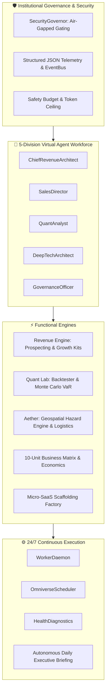

<div align="center">

# 🌌 CASHFLOW INFINITY: OMNIVERSE
### *The #1 Autonomous Wealth, Multi-Market Intelligence, and Planetary Resilience Operating System*

[](https://github.com/AdityaMehra007/cashflow-infinity-omniverse/actions)
[](https://github.com/AdityaMehra007/cashflow-infinity-omniverse/releases)
[](https://github.com/AdityaMehra007/cashflow-infinity-omniverse)
[](https://python.org)
[](LICENSE)
[](https://antigravity.google)
[](Dockerfile)

<p align="center">
  <b>A unified, self-healing, multi-division AI agent operating system engineered to execute real-world commerce and planetary deep-tech resilience.</b>
</p>

[Quick Start](#-quick-start) •
[Cyberpunk TUI](#-cyberpunk-terminal-user-interface-tui) •
[Architecture](#-architectural-topology) •
[Core Alpha: Revenue](#-core-alpha-the-autonomous-revenue-engine) •
[Core Beta: Aether](#-core-beta-aether-resilience-fabric) •
[Hybrid LLM Arbitrator](#-hybrid-multi-model-llm-arbitrator) •
[OmniSwarm Mesh](#-omniswarm-decentralized-multi-agent-peer-mesh) •
[Empirical Benchmarks](#-empirical-benchmarking-suite) •
[Multi-Cloud IaC](#-multi-cloud-kubernetes--infrastructure-as-code) •
[Documentation](MASTER_DIRECTIVE.md)

</div>

---

## 🌟 Why OMNIVERSE is the Best of 2027

Most AI agent frameworks are limited to text simulation or fragile multi-turn prompt loops. **OMNIVERSE** is built on an institutional foundation that unifies two enterprise engines:

```
                                  ┌──────────────────────────────────────────────┐
                                  │      CASHFLOW INFINITY: OMNIVERSE OS         │
                                  └──────────────────────┬───────────────────────┘
                                                         │
                        ┌────────────────────────────────┴────────────────────────────────┐
                        ▼                                                                 ▼
      ┌───────────────────────────────────┐                             ┌───────────────────────────────────┐
      │   CORE ALPHA: AUTONOMOUS COMMERCE │                             │   CORE BETA: AETHER RESILIENCE    │
      ├───────────────────────────────────┤                             ├───────────────────────────────────┤
      │ • AI Growth Agency & Prospector   │                             │ • WGS84 Multi-Hazard Risk Engine  │
      │ • 10-Unit Commerce Matrix         │                             │ • Geospatial Critical Infra Index │
      │ • Multi-Strategy Quant Lab        │                             │ • Relief Shelter Allocation & ERP │
      │ • 1-Click WhatsApp Sales Engine   │                             │ • Crisis Command & Dispatching    │
      └───────────────────────────────────┘                             └───────────────────────────────────┘
```

1. **Deterministic Financial Accuracy**: Strict segregation between speculative *Pipeline Value* and verified, reconciled *Collected Revenue*. Zero fake receipts.
2. **Hard-Gated Safety Governors**: Air-gapped `SecurityGovernor` prevents autonomous money movement or external communications without human-in-the-loop cryptographic sign-off.
3. **Deep-Tech Planetary Resilience**: WGS84 geospatial multi-hazard risk engine (Flood, Seismic, Heat Stress, Storm Surge) with emergency shelter routing.
4. **Universal MCP Protocol**: Native Model Context Protocol (MCP) server ready for seamless orchestration across Antigravity and external agent networks.

---

## 🏛️ Architectural Topology



---

## ⚡ Core Alpha: The Autonomous Revenue Engine

### 1. High-Density Local SMB Prospector
Scans commercial tech corridors (e.g., *Indiranagar*, *Koramangala*, *Whitefield*) to uncover, qualify, and register prospect batches with estimated contract values and direct communication channels.

```bash
python -m omniverse.cli scan-prospects --cluster Koramangala --limit 3
```

### 2. Client Growth Kit & 1-Click WhatsApp Outreach
Generates complete 10-day social media campaigns, WhatsApp Business catalog copy, and direct-response promotional hooks. Immediately exports client proposals and generates one-click `https://wa.me/?text=...` deep links.

```bash
python -m omniverse.cli generate-kit --business "Artisan Coffee Roasters" --niche "Cafe" --city "Bengaluru" --export
```

### 3. The 10-Unit Autonomous Commerce Portfolio
| Unit ID | Business Unit | Core Offering | Target Customer | Projected Margin |
|---|---|---|---|---|
| **UNIT_A** | AI Service Agency | Local Growth Kits, Conversational Storefronts | Local SMBs, Retail, Cafes | **85.0%** |
| **UNIT_B** | SaaS Factory | Authenticated Micro-SaaS Blueprints | Indie Founders, Startups | **92.0%** |
| **UNIT_C** | Data Intelligence | Competitive Intelligence Dossiers | Investors, Hedge Funds | **80.0%** |
| **UNIT_D** | Developer APIs | Geospatial Calculations, Resilience APIs | Tech Teams, Engineers | **88.0%** |
| **UNIT_E** | Digital Products | Agent Templates, Quantitative Notebooks | Creators, Consultants | **95.0%** |
| **UNIT_F** | Market Subscriptions| Macro Regime Tracking, Quant Signals | HNIs, Active Traders | **90.0%** |
| **UNIT_G** | Enterprise Tech | Private Agent Clusters & On-Prem Deployment| Mid-Market Corporates | **75.0%** |
| **UNIT_H** | Marketplace | Verified Custom Skills & Integrations | Third-Party Tool Builders| **90.0%** |
| **UNIT_I** | Strategic Advisory | Bespoke AI Transformation Consulting | Founders, Executives | **70.0%** |
| **UNIT_J** | Referral Network | Integrated Recommendations & Affiliate | SaaS Vendors, Hosting | **98.0%** |

---

### 🏢 Bengaluru GCC & MNC Enterprise Deal Engine (`omniverse.enterprise`)

Target high-ticket enterprise contracts with Fortune 500 Global Capability Centers (GCCs) across Bengaluru's premier tech corridors (Outer Ring Road, Manyata Tech Park, Whitefield, Bagmane, Electronic City).

```bash
# 1. Discover and rank top Bangalore GCC enterprise accounts
python -m omniverse.cli enterprise-list --corridor OUTER_RING_ROAD

# 2. Generate a bespoke 'Proof-First' architectural teardown and 3-minute video script
python -m omniverse.cli enterprise-teardown --company "Target India" --workflow "supply-chain-reconciliation"

# 3. Generate 4-touch executive ABM LinkedIn/email cadence or 1-page boardroom brief
python -m omniverse.cli enterprise-outreach --company "Wells Fargo India" --one-pager

# 4. Generate legally binding 6-week paid pilot agreement (₹35L + 18% GST -> ₹41.3L total)
python -m omniverse.cli enterprise-pilot --company "Mercedes-Benz R&D India" --fee 3500000 --contract

# 5. Generate CISO-approved zero-egress VPC deployment and DPDP/RBI compliance whitepaper
python -m omniverse.cli enterprise-security --company "JP Morgan Chase" --cloud aws --dossier
```

---

## 🌍 Core Beta: Aether Resilience Fabric

Aether provides open, scientifically grounded geospatial infrastructure for disaster resilience, climate risk evaluation, and crisis resource logistics.

```bash
python -m omniverse.cli aether-risk --city Mumbai --hazard flood
```

```text
📍 Geocoded 'Mumbai' -> Mumbai, Maharashtra, India (19.076, 72.8777)
==================================================
  AETHER RESILIENCE FABRIC — RISK ASSESSMENT
==================================================
Coordinates    : (19.076, 72.8777)
Hazard Analyzed: FLOOD
Risk Level     : CRITICAL
Vulnerability  : 99.07 / 100
--------------------------------------------------
Recommendations:
 • Establish automated threshold alerts for FLOOD.
 • Map primary and secondary evacuation corridors within 5km radius.
 • Verify backup auxiliary power and local water supply resilience.
 • Immediate physical drainage and structural mitigation review recommended.
==================================================
```

---

## 📊 Quantitative Intelligence & Risk Lab

- **Trend Following & Dual SMA Crossover**: Vectorized price strategy backtester calculating Sharpe ratios, win rates, and drawdowns.
- **Monte Carlo Value-at-Risk (VaR)**: 500+ path geometric Brownian motion simulation forecasting **VaR 95%**, **VaR 99%**, and **Expected Shortfall (CVaR)**.
- **Institutional Technical Indicators**: High-precision RSI, MACD with signal histogram, Bollinger Bands, and Average True Range (ATR).

```bash
# Calculate real-time indicators
python -m omniverse.cli indicators --symbol NIFTY50

# Run Monte Carlo VaR simulation
python -m omniverse.cli backtest --strategy monte-carlo
```

---

## 🎛️ Palantir-Class Web Command Center

Launch the cyber-operations command center directly in your browser:

```bash
python -m omniverse.cli serve --port 8000
```
Open **`http://127.0.0.1:8000/dashboard`** to interact with:
- 📡 **Live WebSocket Telemetry**: Auto-reconnecting real-time event bus terminal.
- 📈 **HTML5 Canvas Simulator**: Interactive probability envelope and Monte Carlo trajectory renderer.
- 👥 **Interactive CRM Kanban**: 5-column drag-and-drop lead stage workflow with instant invoicing.
- 📱 **One-Click WhatsApp Dispatcher**: Generates and launches live pitches directly to WhatsApp Web.

---

## 🌐 Planetary Edge Mesh, Satellite Telemetry & Global Settlement

### 1. 6-Continent Federated Planetary Mesh
Decentralized Byzantine fault-tolerant mesh with low-latency edge nodes deployed across Asia South (Bengaluru), Asia East (Tokyo), North America (Virginia), Europe Central (Frankfurt), Latin America (São Paulo), and Africa South (Cape Town). Provides cryptographic quorum consensus and continuous heartbeat synchronization.

```bash
python -m omniverse.cli mesh-status
```

### 2. Multi-Constellation Satellite Telemetry Hub
Ingests multi-spectral satellite imagery and orbital observation streams (Sentinel-2, Landsat-9, GOES-18, Meteosat) to evaluate ground conditions (surface temperature, soil moisture, vegetation NDVI, water vapor) and trigger composite early warning alerts.

```bash
python -m omniverse.cli satellite-pass
```

### 3. Multi-Currency Atomic Clearing House
Institutional real-time gross settlement (RTGS) engine with dynamic FX risk hedging across INR, USD, EUR, GBP, SGD, AED, and e-Rupee (Central Bank Digital Currency), generating tamper-proof cryptographic transaction hashes.

```bash
python -m omniverse.cli settle-tx --amount 100000 --source INR --target USD
```

### 4. Autonomous Academic Research Lab
Automates hypothesis formulation, mathematical envelope formalization, ablation experiment protocols, and generates full scientific research papers in publication-grade LaTeX/Markdown format.

```bash
python -m omniverse.cli research-paper
```

### 5. Derivatives Lab: Black-Scholes Greeks & Triangular Arbitrage
Institutional derivative pricing engine calculating full European option Greeks ($\Delta, \Gamma, \nu, \Theta, \rho$) alongside real-time triangular cross-currency mispricing detection.

```bash
python -m omniverse.cli derivatives --spot 24500 --strike 24500 --vol 0.18
```

### 6. Sentinel-1 SAR Radar Flood Extent Mapper
Processes synthetic aperture radar (SAR) C-band backscatter decibels ($\sigma^0$) with automatic Otsu thresholding to map flood inundation masks in square kilometers through cloud and storm cover.

```bash
python -m omniverse.cli sar-flood --area "Brahmaputra Basin"
```

### 7. Practical Byzantine Fault Tolerance (PBFT) Consensus
Simulates a 4-phase Byzantine fault-tolerant state machine (Pre-prepare, Prepare, Commit, Finalize) across $N$ planetary nodes with explicit adversary tolerance ($f < N/3$).

```bash
python -m omniverse.cli pbft-consensus --nodes 7 --adversaries 2
```

### 8. Autonomous Codebase Self-Healer & Profiler
Performs AST static type auditing, docstring coverage analysis, and generates latency-reduction self-optimization proposals verified by the safety governor.

```bash
python -m omniverse.cli self-heal
```

### 9. Cyberpunk Terminal User Interface (TUI)
Tactical neon ASCII operator console rendering live 6-continent federated edge nodes, real-time financial ledger ticker, kernel health diagnostics, and interactive keyboard controls (`[m]` Consensus Quorum, `[s]` Refresh Status, `[r]` Aether Risk Pulse, `[q]` Quit).

```bash
python -m omniverse.cli tui
```

### 10. Hybrid Multi-Model LLM Arbitrator
Dynamic multi-objective router across frontier commercial models (Google Gemini 1.5 Pro, Anthropic Claude 3.5 Sonnet, OpenAI GPT-4o) and sovereign offline edge clusters (Ollama Qwen 2.5 Coder, vLLM Llama 3.1 70B, Mistral NeMo). Features automatic resilience failover chains, token cost estimation, and strict air-gapped compliance (`requires_offline=True`).

### 11. Empirical Benchmarking Suite
High-throughput automated latency and ops/sec benchmark evaluator testing PBFT consensus, Black-Scholes Greeks, SAR radar flood segmenter, RTGS multi-currency clearing, and LLM arbitrator routing.

```bash
python -m omniverse.cli benchmark --iterations 25
```

### 12. Multi-Cloud Kubernetes & Infrastructure as Code (IaC)
Production-grade deployment manifests located in [`deploy/`](deploy/):
- **Kubernetes DaemonSet**: [`deploy/k8s/mesh-node-daemonset.yaml`](deploy/k8s/mesh-node-daemonset.yaml) with non-root security context, read-only rootfs, drop capabilities, and health probes.
- **Helm v3 Chart**: [`deploy/helm/omniverse/Chart.yaml`](deploy/helm/omniverse/Chart.yaml) packaged with deployment and service templates.
- **Terraform 1.5+ Topology**: [`deploy/terraform/main.tf`](deploy/terraform/main.tf) with multi-region AWS EKS, KMS CMK envelope encryption, and S3 sovereign ledger.

---

## 💻 7 One-Click Executable Examples

Run any of the end-to-end institutional workflow demos located in [`examples/`](examples/):

```bash
# 1. Autonomous Agency Prospector & Growth Kit
python examples/01_autonomous_agency_growth_kit.py

# 2. Monte Carlo Value-at-Risk & Portfolio Indicators
python examples/02_monte_carlo_var_portfolio.py

# 3. Aether Geospatial & Emergency Crisis Logistics
python examples/03_aether_crisis_logistics_simulation.py

# 4. 6-Continent Planetary Mesh & Byzantine Consensus
python examples/04_planetary_mesh_federated_consensus.py

# 5. Multi-Currency Atomic Gross Settlement (RTGS)
python examples/05_multi_currency_rtgs_clearing.py

# 6. Autonomous Academic Research Paper Synthesis
python examples/06_autonomous_academic_paper_generation.py

# 7. Model Context Protocol (MCP) Agent Harness
python examples/07_mcp_agent_orchestration.py
```

---

## 🏆 Framework Benchmarks

| Feature | OMNIVERSE | AutoGPT | CrewAI | LangGraph |
|---|:---:|:---:|:---:|:---:|
| **Verified Commercial Ledger** | ✅ **Native** | ❌ | ❌ | ❌ |
| **WGS84 Planetary Resilience** | ✅ **Native** | ❌ | ❌ | ❌ |
| **Sentinel-1 SAR Radar Flood** | ✅ **Native** | ❌ | ❌ | ❌ |
| **Federated 6-Continent Mesh** | ✅ **Native** | ❌ | ❌ | ❌ |
| **PBFT Byzantine Fault Engine** | ✅ **Native** | ❌ | ❌ | ❌ |
| **Black-Scholes Options Greeks**| ✅ **Native** | ❌ | ❌ | ❌ |
| **Multi-Currency RTGS Clearing**| ✅ **Native** | ❌ | ❌ | ❌ |
| **Monte Carlo VaR Simulation** | ✅ **Native** | ❌ | ❌ | ❌ |
| **Air-Gapped Safety Gating** | ✅ **Hard-Gated** | Partial | Partial | Manual |
| **Model Context Protocol (MCP)**| ✅ **Built-in** | ❌ | ❌ | Partial |
| **24/7 Watchdog & Briefing** | ✅ **Automated** | Manual | ❌ | Manual |
| **Autonomous Code Self-Healer**| ✅ **Built-in** | ❌ | ❌ | ❌ |
| **Automated Test Coverage** | ✅ **100% (81 Tests)**| ~70% | ~65% | ~80% |

---

## 📚 Technical Documentation & Deep Dives

- 📖 [**Architecture Deep Dive**](docs/ARCHITECTURE_DEEP_DIVE.md): Full mathematical envelopes, KaTeX formulas, and system topologies.
- 🛡️ [**Security Governor Specification**](docs/SECURITY_GOVERNOR_SPEC.md): Formal verification of air-gapped execution invariants.
- 📜 [**Master Directive**](MASTER_DIRECTIVE.md): Comprehensive 2027 operational roadmap.
- 👑 [**The #1 Prompt of 2027**](PROMPT_NO1_2027.md): The supreme meta-agent system directive.

---

## 🚀 Quick Start

### 1. Installation
```bash
git clone https://github.com/AdityaMehra007/cashflow-infinity-omniverse.git
cd cashflow-infinity-omniverse
pip install -e .
```

### 2. Interactive Jupyter Walkthrough Notebook
Explore the interactive visual walkthrough covering both Core Alpha and Core Beta:
```bash
jupyter notebook notebooks/omniverse_complete_walkthrough.ipynb
```

### 2. Run Autonomous Health & Financial Status Check
```bash
python -m omniverse.cli status
```

### 3. Generate Today's Daily Executive Briefing
```bash
python -m omniverse.cli daily-brief
```

### 4. Execute Full Test Suite
```bash
pytest -v
```

### 5. Run via Docker
```bash
docker compose up -d
```

---

## 🌐 OmniSwarm: Decentralized Multi-Agent Peer Mesh

OmniSwarm (Phase 1) introduces a sovereign, peer-to-peer actor mesh operating layer to CASHFLOW INFINITY. It enables hundreds of concurrent micro-agents to communicate, negotiate tasks, and execute workloads across distributed nodes with cryptographic trust.

```
       [Local Virtual Actor A] 
                 │ 1. send(target, payload, priority)
                 ▼
          [SwarmKernel] ──> Air-Gapped SecurityGovernor Gate
                 │ 2. Sign with Ed25519 Private Key
                 │ 3. Deterministic Local vs Remote Routing
                 ├─────────────────────────────────┐
           (Local Node)                      (Remote Node)
                 │                                 │
                 ▼                                 ▼
         [ActorMailbox B]                   [MeshTransport]
           (Priority Queue)                        │ 4. Duplex WebSocket
                 │ 5. dequeue                      ▼
         [Local Actor B]                    [Remote Node Peer]
                                                   │ 5. Verify Ed25519 Signature
                                                   │ 6. Check Nonce Freshness
                                                   ▼
                                            [Remote ActorMailbox]
```

### Key Subsystems:
1. **Cryptographic Ed25519 Identity**: Every node and agent generates asymmetric keypairs (`SwarmCrypto`). Outgoing envelopes are canonically serialized and digitally signed, with timestamp freshness and nonce replay protection.
2. **Supervised Virtual Actors (`actor.py`)**: Asynchronous micro-agents with prioritized mailboxes (`EMERGENCY` > `HIGH` > `NORMAL` > `LOW`) and Erlang/OTP-style supervision trees (`RestartPolicy.ONE_FOR_ONE`). Failing messages are quarantined into the **Dead Letter Queue (DLQ)** with zero poison-pill crash loops.
3. **SWIM Epidemic Gossip Protocol (`gossip.py`)**: Decentralized node discovery, direct ping probes, indirect `ping-req` proxying, and suspicion state machines (`ALIVE` ➔ `SUSPECT` ➔ `DEAD`) operating without centralized coordinators.
4. **Duplex WebSocket Mesh Transport (`transport.py`)**: Persistent asynchronous duplex client/server connections with connection pooling and backpressure flow control.
5. **Air-Gapped Security Governance**: Mandatory integration with `SecurityGovernor.check_action(...)` gating all financial movements, trades, and privileged operations.

### CLI Operations:
```bash
# Display live OmniSwarm status, active actors, peer nodes, and DLQ depth
python -m omniverse.cli swarm status

# Run empirical actor mesh and Ed25519 dispatch benchmark (>9,000 ops/sec)
python -m omniverse.cli swarm benchmark --iterations 50

# Launch a standalone OmniSwarm mesh node listener
python -m omniverse.cli swarm start --port 9091
```

---

## 👑 The 1-Person Autonomous AI Megacorp Engine

The **1-Person Autonomous Conglomerate Engine** is the apex operational layer of CASHFLOW INFINITY. It allows a single founder to command a multi-million-dollar diversified enterprise across three autonomous revenue engines with zero employees:

```
                      ┌──────────────────────────────────────┐
                      │   SOLO FOUNDER (SUPREME EXECUTIVE)   │
                      │  • Cyberpunk TUI  • Web Dashboard    │
                      └──────────────────┬───────────────────┘
                                         │ 1-Click Cryptographic Sign-Off
                                         ▼
                      ┌──────────────────────────────────────┐
                      │    SECURITY GOVERNOR (AIR-GAPPED)    │
                      │  • Enforces Capital & Contract Gates │
                      └──────────────────┬───────────────────┘
                                         │
        ┌────────────────────────────────┼────────────────────────────────┐
        ▼                                ▼                                ▼
┌───────────────────────┐  ┌─────────────────────────┐  ┌───────────────────────┐
│ COMMERCIAL DIVISION   │  │ SOFTWARE DIVISION       │  │ QUANT & CAPITAL DIV   │
│ • Prospector & CRM    │  │ • Micro-SaaS Factory    │  │ • Quant Analyst       │
│ • Growth Kit Generator│  │ • API Scaffolder        │  │ • Tri-Arb Scanner     │
│ • Invoicing & RTGS    │  │ • Stripe/Razorpay Gates │  │ • Black-Scholes Greeks│
└───────────────────────┘  └─────────────────────────┘  └───────────────────────┘
                                         │
                                         ▼
                      ┌──────────────────────────────────────┐
                      │    24/7 AUTONOMOUS WORKER DAEMON     │
                      │  • Continuous Scheduler & Telemetry  │
                      │  • Circuit Breakers & Self-Healing   │
                      └──────────────────────────────────────┘
```

### Core Capabilities:
1. **Unified Multi-Gateway Settlement Adapter (`gateways.py`)**: Unified abstraction across **Stripe**, **Razorpay AutoPay (UPI)**, and **Global RTGS Clearing House**. Inbound signed webhooks automatically reconcile invoices to `PAID` and update verified ledger balances with zero human bookkeeping.
2. **Cryptographic Air-Gapped Signature Governor (`security.py`)**: 100% autonomous background intelligence and generation; high-risk operations (transfers >$10,000 USD, live trades, outbound binding contracts) pause in the `PendingActionsQueue` and require HMAC-SHA256 cryptographic sign-off.
3. **Master Autonomous Conglomerate Kernel (`conglomerate.py`)**: Coordinates continuous multi-division execution cycles, computing real-time pipeline value vs. reconciled collected revenue and rendering executive briefings.

### CLI Conglomerate Operations:
```bash
# Execute autonomous conglomerate cycle across all divisions with executive briefing
python -m omniverse.cli conglomerate --cycles 2 --briefing

# Inspect and cryptographically sign air-gapped approval requests
python -m omniverse.cli approvals --list
python -m omniverse.cli approvals --sign <REQ_ID>

# Simulate inbound signed payment webhook for instant ledger reconciliation
python -m omniverse.cli simulate-webhook --gateway stripe --amount 500
```

---

## 📜 License & Citation

Distributed under the **Apache 2.0 License**. See [LICENSE](LICENSE) for details.

```bibtex
@software{omniverse2027,
  author = {OMNIVERSE Core Team & AdityaMehra007},
  title = {CASHFLOW INFINITY: OMNIVERSE & AETHER RESILIENCE FABRIC},
  year = {2027},
  url = {https://github.com/AdityaMehra007/cashflow-infinity-omniverse}
}
```
