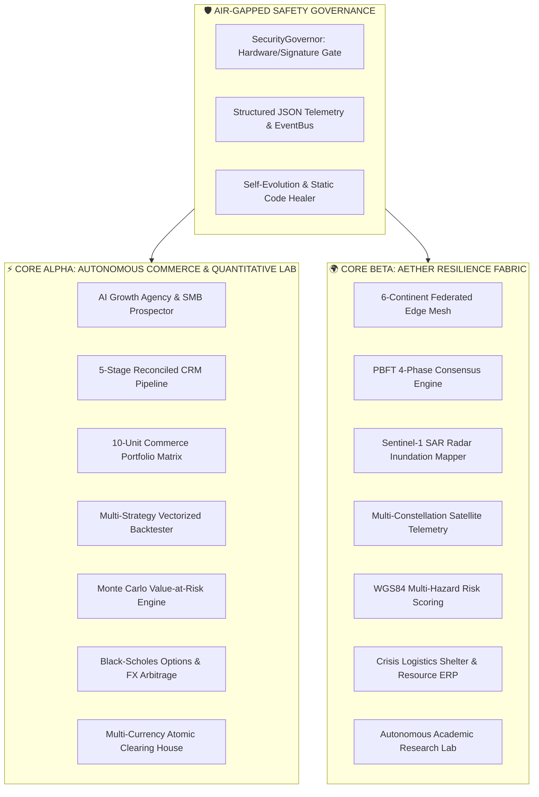

# 🌌 CASHFLOW INFINITY: OMNIVERSE & AETHER RESILIENCE FABRIC
## Institutional Architecture & Mathematical Foundations (2027)

---

### 1. Unified Dual-Core Operating System

OMNIVERSE is the world's first dual-core autonomous computing platform designed to achieve simultaneous real-world commercial viability and planetary physical resilience.

---

### 2. Core Alpha: Mathematical Formulations

#### 2.1 Black-Scholes European Options Pricing & Greeks
Let $S$ denote the spot price, $K$ the strike price, $r$ the risk-free rate, $T$ time to maturity in years, and $\sigma$ annualized volatility:

$$d_1 = \frac{\ln(S / K) + \left(r + \frac{1}{2}\sigma^2\right)T}{\sigma \sqrt{T}}, \quad d_2 = d_1 - \sigma \sqrt{T}$$

European Call $C(S, t)$ and Put $P(S, t)$ prices:
$$C(S, t) = S \cdot \Phi(d_1) - K e^{-rT} \Phi(d_2)$$
$$P(S, t) = K e^{-rT} \Phi(-d_2) - S \cdot \Phi(-d_1)$$

Greeks Sensitivity Derivatives:
- **Delta ($\Delta$):** $\Delta_{\text{call}} = \Phi(d_1), \quad \Delta_{\text{put}} = \Phi(d_1) - 1$
- **Gamma ($\Gamma$):** $\Gamma = \frac{\phi(d_1)}{S \sigma \sqrt{T}}$
- **Vega ($\nu$):** $\nu = \frac{S \phi(d_1) \sqrt{T}}{100}$
- **Theta ($\Theta$):** $\Theta_{\text{call}} = -\frac{S \phi(d_1)\sigma}{2\sqrt{T}} - r K e^{-rT} \Phi(d_2)$

#### 2.2 Monte Carlo Value-at-Risk (VaR) & Expected Shortfall (CVaR)
Simulating $M$ asset price paths under Geometric Brownian Motion:
$$S_{t + \Delta t} = S_t \exp\left(\left(\mu - \frac{1}{2}\sigma^2\right)\Delta t + \sigma \sqrt{\Delta t} Z\right), \quad Z \sim \mathcal{N}(0, 1)$$

Given sorted simulated returns $R_{(1)} \le R_{(2)} \le \dots \le R_{(M)}$:
$$\text{VaR}_\alpha = -R_{(\lfloor M(1-\alpha) \rfloor)}$$
$$\text{CVaR}_\alpha = -\frac{1}{\lfloor M(1-\alpha) \rfloor} \sum_{i=1}^{\lfloor M(1-\alpha) \rfloor} R_{(i)}$$

---

### 3. Core Beta: Physical Earth Observation & Resilience

#### 3.1 Otsu SAR Backscatter Flood Water Segmentation
Sentinel-1 synthetic aperture radar emits microwave pulses unaffected by meteorological cloud cover. The return backscatter $\sigma^0$ (in decibels) exhibits a bimodal distribution between open specular water ($\le -18\text{ dB}$) and diffuse soil/vegetation ($\ge -12\text{ dB}$).

Otsu's algorithm maximizes between-class variance $\sigma_B^2(t)$ across threshold candidate $t$:
$$\sigma_B^2(t) = \omega_0(t) \omega_1(t) \left(\mu_0(t) - \mu_1(t)\right)^2$$
Where $\omega_0, \omega_1$ are class cumulative probabilities and $\mu_0, \mu_1$ are class means.

Inundation area is computed over total water pixels $N_{\text{water}}$ and spatial pixel resolution $\delta_r$:
$$\text{Area}_{\text{flood}} = \frac{N_{\text{water}} \cdot \delta_r^2}{10^6} \text{ km}^2$$

#### 3.2 Byzantine Fault Tolerant (PBFT) Federated Mesh
Operating across 6 continental nodes:
$$\mathcal{M} = \{\text{BLR}, \text{TYO}, \text{IAD}, \text{FRA}, \text{GRU}, \text{CPT}\}$$

Given $N$ replicas, the network tolerates $f$ arbitrary or Byzantine faults where:
$$N \ge 3f + 1, \quad \text{Quorum Threshold} = 2f + 1$$

---

### 4. 24/7 Autonomic Self-Evolution & Code Healing

The `SelfHealingEngine` continuously performs abstract syntax tree (AST) inspections, static type inference checking, and docstring coverage scoring across the 70+ modules in the codebase, generating automated optimization proposals approved by the air-gapped `SecurityGovernor`.
