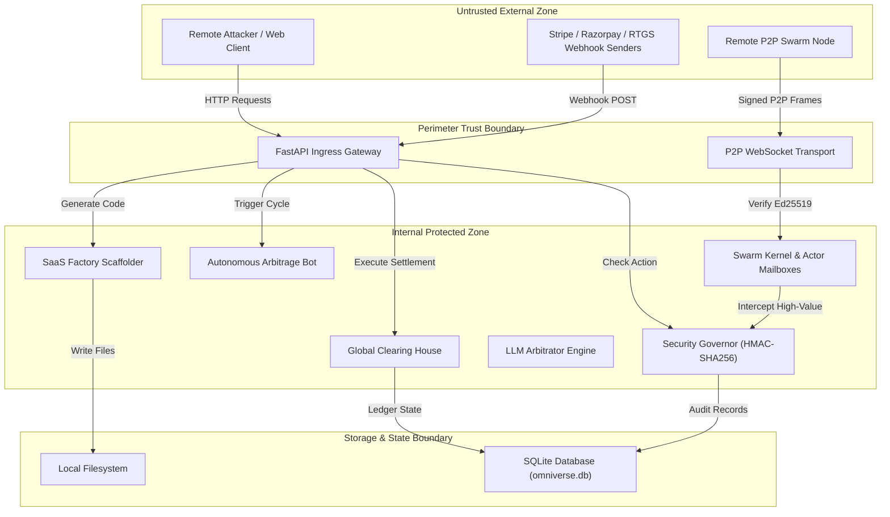

# Threat Model: CASHFLOW INFINITY: OMNIVERSE

## Executive summary

CASHFLOW INFINITY: OMNIVERSE is a hybrid autonomous multi-agent operating system, financial clearing engine, and multi-vertical enterprise automation platform. The primary architectural risk centers on financial fund movement, autonomous execution interfaces, and cryptographic ingress points. While the core swarm engine implements an air-gapped `SecurityGovernor` with HMAC-SHA256 human-in-the-loop approvals for transactions exceeding $10,000 USD and Ed25519 digital signatures for P2P mesh communication, several high-impact perimeter attack surfaces bypass these controls. In particular, unauthenticated atomic settlement endpoints (`/clearing/settle` and `/webhooks/rtgs`), permissive default host filtering (`*` in `TrustedHostMiddleware`), unauthenticated autonomous arbitrage execution triggers (`/finance/arbitrage/bot/cycle`), and unvalidated directory arguments in SaaS scaffolding (`/saas/scaffold`) present immediate vectors for unauthorized treasury draining, arbitrary disk writes, and perimeter integrity compromise.

## Scope and assumptions

### In-Scope Paths
- **API Ingress & Gateways:** `src/omniverse/api/app.py`, `src/omniverse/api/routes/webhooks.py`, `src/omniverse/api/routes/clearing.py`, `src/omniverse/api/routes/finance.py`, `src/omniverse/api/routes/saas.py`, `src/omniverse/api/routes/revenue.py`.
- **Security & Governance:** `src/omniverse/core/security.py`, `src/omniverse/core/config.py`.
- **Agent Swarm & P2P Transport:** `src/omniverse/swarm/kernel.py`, `src/omniverse/swarm/crypto.py`, `src/omniverse/swarm/transport.py`.
- **Model Arbitration & Orchestration:** `src/omniverse/core/llm_arbitrator.py`, `src/omniverse/mcp/server.py`.
- **Financial Clearing & Settlement:** `src/omniverse/modules/settlement/clearing.py`, `src/omniverse/modules/revenue/gateways.py`, `src/omniverse/modules/revenue/payments.py`.

### Out-of-Scope Items
- Upstream third-party LLM inference provider internal weights and cloud infrastructure (Google Gemini, Anthropic Claude, OpenAI).
- External clearing networks and banking rails (e.g., RBI RTGS core banking network hardware, external Stripe/Razorpay internal banking infrastructure).
- Local developer terminal physical security and air-gapped cold hardware key generation storage.

### Explicit Assumptions
- The application may be exposed to public or semi-public networks via HTTP/WebSocket reverse proxies or direct internet edge deployment.
- Attackers have network connectivity to exposed HTTP endpoints and WebSocket ports but do not possess valid HMAC signing secrets (`stripe_webhook_secret`, `razorpay_key_secret`) or internal node private keys unless exfiltrated.
- SQLite is utilized as the default state store (`data/omniverse.db`) with concurrent multithreaded access managed via SQLModel/SQLAlchemy session pools.
- The `SecurityGovernor` default capital ceiling is $10,000.00 USD, above which human operator consent is mandatory.

### Open Questions Materially Affecting Risk Ranking
1. **Perimeter Authentication:** Is an external API gateway (e.g., Kong, Cloudflare Access, AWS API Gateway) providing mTLS or Bearer token authentication in front of `/api/v1/*`, or is FastAPI directly exposed to untrusted traffic?
2. **Webhook Exposure:** Are the `/webhooks/*` endpoints intended to be reachable by public webhook dispatchers without IP allowlisting or mutual TLS?
3. **P2P Swarm Topology:** Does the Swarm WebSocket transport operate within an isolated private VPC/LAN or across the public internet with peer node discovery?

## System model

### Primary components
- **FastAPI HTTP/WebSocket Gateway (`src/omniverse/api/app.py`):** Central entry point routing REST API endpoints, WebSockets, HTML dashboards, and webhook ingress.
- **Security Governor (`src/omniverse/core/security.py`):** Human-in-the-loop permission gateway enforcing HMAC-SHA256 signature verification and capital movement caps.
- **Unified Payment Router & Ingress (`src/omniverse/api/routes/webhooks.py`, `src/omniverse/modules/revenue/gateways.py`):** Parses and validates payment notifications from Stripe, Razorpay, and RTGS clearing rails.
- **Global Clearing House (`src/omniverse/modules/settlement/clearing.py`, `src/omniverse/api/routes/clearing.py`):** Real-time gross settlement engine maintaining multi-currency liquidity reserves and FX conversions.
- **Autonomous Arbitrage Engine (`src/omniverse/modules/finance/arbitrage_bot.py`, `src/omniverse/api/routes/finance.py`):** Automated bot executing triangular currency arbitrage cycles.
- **SaaS Factory Scaffolder (`src/omniverse/modules/saas_factory/scaffolder.py`, `src/omniverse/api/routes/saas.py`):** File generation engine creating tenant workspaces and application boilerplate.
- **OmniSwarm P2P Kernel (`src/omniverse/swarm/kernel.py`, `src/omniverse/swarm/crypto.py`):** Distributed actor runtime with Ed25519 digital signatures and message envelopes.
- **MCP Server Provider (`src/omniverse/mcp/server.py`):** Exposes core tool abstractions to AI harnesses and IDE agents.
- **Database Engine (`src/omniverse/core/database.py`):** SQLModel engine persisting financial ledgers, audit records, leads, and invoices.

### Data flows and trust boundaries
- **Internet / Untrusted Clients -> FastAPI Gateway (`/api/v1/*`):**
  - *Data Types:* HTTP JSON requests, query parameters, multipart form bodies, WebSocket connection frames.
  - *Channel:* HTTP/1.1, HTTP/2, WebSocket (TLS expected at reverse proxy).
  - *Guarantees:* `TrustedHostMiddleware` (configured with wildcard `*` fallback), basic security response headers (`CSP`, `X-Frame-Options: DENY`, `X-Content-Type-Options: nosniff`).
  - *Validation:* Pydantic schema validation at route handlers; missing route-level authentication on administrative and clearing routes.
- **External Payment Gateways -> Webhook Ingress (`/webhooks/*`):**
  - *Data Types:* Signed webhook payloads, HMAC headers (`stripe-signature`, Razorpay signatures, raw JSON).
  - *Channel:* HTTPS POST.
  - *Guarantees:* HMAC-SHA256 validation for Stripe and Razorpay; no signature validation for RTGS.
  - *Validation:* Stripe adapter validates timestamp and signature; Razorpay validates hash; RTGS performs no cryptographic validation.
- **FastAPI Gateway -> Security Governor (`src/omniverse/core/security.py`):**
  - *Data Types:* `ActionType` enums, action payload dictionaries, signature hashes.
  - *Channel:* Internal Python method invocations.
  - *Guarantees:* Memory cache and SQLModel audit table recording; HMAC-SHA256 verification against secret key.
  - *Validation:* Threshold checks (`CAPITAL_THRESHOLD_USD = 10000.0`); action type normalization.
- **FastAPI Routes -> SaaS Factory File Scaffolder (`src/omniverse/modules/saas_factory/scaffolder.py`):**
  - *Data Types:* File paths, project names, template strings.
  - *Channel:* Local filesystem I/O (`pathlib.Path`).
  - *Guarantees:* None; lacks path normalization or root jail checks.
  - *Validation:* Basic Pydantic string typing without directory traversal sanitization.
- **Swarm Peer Node -> Swarm Kernel (`src/omniverse/swarm/transport.py`):**
  - *Data Types:* JSON-serialized `SwarmMessage` envelopes containing sender IDs, actor targets, and arbitrary payloads.
  - *Channel:* WebSocket TCP.
  - *Guarantees:* Ed25519 digital signature validation over canonical JSON representations via `SwarmCrypto.verify_signature`.
  - *Validation:* Nonce, timestamp, and signature validation before actor mailbox delivery.

#### Diagram

## Assets and security objectives

| Asset | Why it matters | Security objective (C/I/A) |
|---|---|---|
| **Treasury & Liquidity Reserves** | Multi-currency balances held across INR, USD, EUR, and Digital Rupee corridors. Unauthorized movement causes catastrophic financial loss. | **Integrity & Availability** |
| **Air-Gap HMAC Signing Keys** | Secrets used to authorize high-value transactions and verify administrative approvals. Compromise allows complete governance bypass. | **Confidentiality & Integrity** |
| **Financial Audit Ledger** | Immutable record of settled transactions, audit approvals, and invoice states in `security_audit_records`. Essential for regulatory compliance and dispute resolution. | **Integrity & Availability** |
| **Local Filesystem & Source Code** | Application source, configuration files, and server host environment. Unauthorized writes enable remote code execution. | **Confidentiality & Integrity** |
| **Payment Gateway Webhook Secrets** | `stripe_webhook_secret` and `razorpay_key_secret`. Compromise allows attackers to forge payment success webhooks and mark invoices paid for free. | **Confidentiality & Integrity** |
| **P2P Node Private Keys (Ed25519)** | Sovereign cryptographic identity of swarm nodes. Theft allows impersonation of orchestrator or governance actors. | **Confidentiality & Integrity** |
| **Customer PII & Lead Records** | Prospect business names, WhatsApp phone numbers, contact persons, and financial deal sizes. | **Confidentiality** |

## Attacker model

### Capabilities
- **Unauthenticated Remote Web Attacker:** Can send arbitrary HTTP GET/POST requests and WebSocket connections to any public-facing port; can supply malicious query parameters, JSON bodies, and forged headers (e.g., `Host`, `X-Forwarded-For`).
- **Malicious Webhook Spoofer:** Can craft HTTP POST requests to `/webhooks/stripe`, `/webhooks/razorpay`, and `/webhooks/rtgs` attempting to trigger fraudulent order fulfillment without payment.
- **Compromised P2P Network Participant:** Can join the swarm network or capture network traffic; can craft malformed `SwarmMessage` envelopes or attempt replay attacks with valid timestamps.
- **Untrusted Multi-Tenant User:** Can invoke public API endpoints such as `/saas/scaffold` or `/revenue/growth-kit` with crafted payload parameters.

### Non-capabilities
- Cannot break Ed25519 or HMAC-SHA256 cryptographic primitives through brute-force computation.
- Cannot intercept or tamper with out-of-band air-gapped human operator decisions unless the operator's machine or communication channel is compromised.
- Cannot write directly to the local SQLite database file on disk without an application-layer vulnerability or host compromise.

## Entry points and attack surfaces

| Surface | How reached | Trust boundary | Notes | Evidence (repo path / symbol) |
|---|---|---|---|---|
| **`/api/v1/clearing/settle`** | Public HTTP POST | Perimeter -> Core Clearing | Unauthenticated endpoint executing atomic currency gross settlement; completely bypasses `SecurityGovernor`. | `src/omniverse/api/routes/clearing.py:execute_settlement` |
| **`/api/v1/webhooks/rtgs`** | Public HTTP POST | Perimeter -> Payment Workflow | Unauthenticated endpoint that settles invoices and invokes clearing house without cryptographic signature check. | `src/omniverse/api/routes/webhooks.py:rtgs_settlement` |
| **`/api/v1/finance/arbitrage/bot/cycle`** | Public HTTP POST | Perimeter -> Trading Engine | Unauthenticated endpoint triggering automated multi-market currency arbitrage execution. | `src/omniverse/api/routes/finance.py:trigger_arbitrage_cycle` |
| **`/api/v1/saas/scaffold`** | Public HTTP POST | Perimeter -> Local Filesystem | Accepts unsanitized `target_dir` parameter passed directly to `Path()`, permitting arbitrary directory creation and file writes. | `src/omniverse/api/routes/saas.py:scaffold_saas` |
| **`/api/v1/webhooks/stripe`** | Public HTTP POST | Perimeter -> Payment Workflow | Verifies HMAC signature, but defaults secret to `"whsec_mock"` if unconfigured, allowing forgery in test/dev deployments. | `src/omniverse/api/routes/webhooks.py:stripe_webhook` |
| **`/api/v1/webhooks/razorpay`** | Public HTTP POST | Perimeter -> Payment Workflow | Verifies HMAC signature, but defaults secret to `"rzp_sec_mock"` if unconfigured. | `src/omniverse/api/routes/webhooks.py:razorpay_webhook` |
| **TrustedHostMiddleware** | Ingress HTTP Header | Perimeter -> FastAPI Gateway | Configured with `*` in default allowed hosts list, enabling HTTP Host header poisoning and cache poisoning. | `src/omniverse/core/config.py:OmniverseSettings.allowed_hosts` |
| **P2P Swarm Transport** | WebSocket Ingress | Network -> Swarm Kernel | Processes incoming frames; verifies Ed25519 signature but requires peer public key pinning to prevent rogue nodes. | `src/omniverse/swarm/transport.py:WebSocketTransport` |

## Top abuse paths

1. **AP-01: Fraudulent Invoice Reconciliation via Unauthenticated RTGS Webhook**
   - *Goal:* Mark high-value enterprise invoices as paid and clear balances without transferring real funds.
   - *Steps:*
     1. Attacker queries public invoice endpoint or predicts invoice ID.
     2. Attacker issues HTTP POST to `/api/v1/webhooks/rtgs` with `{"invoice_id": 101, "sender_id": "ROGUE_SENDER", "source_amount": 500000.0}`.
     3. The endpoint processes the settlement via `RTGSGatewayAdapter` without checking authentication or cryptographic signature.
     4. `PaymentWorkflow.record_payment()` updates invoice status to `PAID` in `data/omniverse.db`.
   - *Impact:* Complete reconciliation bypass and theft of enterprise goods/services.

2. **AP-02: Direct Treasury Liquidity Depletion via Unauthenticated Clearing Settlement**
   - *Goal:* Drain multi-currency reserves from the Omniverse clearing house.
   - *Steps:*
     1. Attacker calls `/api/v1/clearing/reserves` to inspect operational reserve balances.
     2. Attacker invokes `/api/v1/clearing/settle` with crafted `sender_id`, `recipient_id`, and `source_amount`.
     3. `_clearing_house.execute_atomic_settlement` transfers funds between accounts without authentication or `SecurityGovernor` approval.
   - *Impact:* Depletion of operational liquidity reserves and distortion of FX treasury balance.

3. **AP-03: Arbitrary File Write & Code Execution via SaaS Scaffolder Path Traversal**
   - *Goal:* Plant malicious executable files or overwrite system files on the host server.
   - *Steps:*
     1. Attacker sends HTTP POST to `/api/v1/saas/scaffold` with `{"name": "pwned", "target_dir": "../../../../../var/www"}`.
     2. The route passes `Path(req.target_dir)` to `SaaSFactoryScaffolder.scaffold_project()`.
     3. Scaffolder generates files (`main.py`, `.env`, configuration templates) inside the traversed directory.
   - *Impact:* Host filesystem compromise, code injection, and potential remote code execution.

4. **AP-04: Fraudulent Stripe/Razorpay Webhook Replay using Hardcoded Default Mock Secrets**
   - *Goal:* Forge verified payment confirmations when the application runs in default configuration.
   - *Steps:*
     1. Attacker inspects public repository source and notes default secrets `"whsec_mock"` and `"rzp_sec_mock"`.
     2. In an environment where environment variables are unset, attacker computes a valid HMAC-SHA256 signature using `"whsec_mock"`.
     3. Attacker POSTs payload to `/api/v1/webhooks/stripe` with valid header `Stripe-Signature: t=...,v1=<computed_hash>`.
     4. Gateway accepts payload as verified and marks target invoice as paid.
   - *Impact:* Unauthorized payment bypass in staging, production, or misconfigured environments.

5. **AP-05: Denial of Service and Financial Shock via Automated Arbitrage Execution Flooding**
   - *Goal:* Force continuous capital deployment and lock liquidity reserves.
   - *Steps:*
     1. Attacker repeatedly issues concurrent HTTP POST requests to `/api/v1/finance/arbitrage/bot/cycle`.
     2. The endpoint invokes `AutonomousArbitrageBot.execute_arbitrage_cycle()` with high capital allocations without rate limits or authentication.
     3. Concurrent trade executions exhaust database locks and compute cycles while manipulating simulated/live book positions.
   - *Impact:* Server resource exhaustion, treasury lockup, and operational denial of service.

6. **AP-06: Host Header Poisoning via Permissive Wildcard Ingress**
   - *Goal:* Poison password reset, redirect, or checkout URLs generated by the application.
   - *Steps:*
     1. Attacker sends requests with a spoofed `Host: attacker.domain` header.
     2. `TrustedHostMiddleware` allows the request because `*` is present in `OmniverseSettings.allowed_hosts`.
     3. The server generates redirect responses or checkout callbacks reflecting the poisoned host.
   - *Impact:* Credential theft and phishing of legitimate clients.

## Threat model table

| Threat ID | Threat source | Prerequisites | Threat action | Impact | Impacted assets | Existing controls (evidence) | Gaps | Recommended mitigations | Detection ideas | Likelihood | Impact severity | Priority |
|---|---|---|---|---|---|---|---|---|---|---|---|---|
| **TM-001** | Remote Network Attacker | Network access to HTTP port | Sends unauthenticated POST to `/api/v1/clearing/settle` executing large gross currency transfer. | Financial treasury depletion; unauthorized reserve reallocation. | Treasury Liquidity Reserves | None on route handler. `SecurityGovernor` exists in `src/omniverse/core/security.py` but is unreferenced in clearing route. | Route lacks authentication, authorization, and governor interception. | Require Bearer API key authentication and route all settlements through `SecurityGovernor.intercept_action(ActionType.FINANCIAL_TRANSFER)`. | Alert on all `/clearing/settle` requests exceeding threshold; log source IP and user agent. | High | Critical | **Critical** |
| **TM-002** | Remote Network Attacker | Network access to webhook ingress | Sends unauthenticated POST to `/api/v1/webhooks/rtgs` specifying arbitrary `invoice_id` and amount. | Invoices falsely marked as paid; business services delivered without payment. | Financial Audit Ledger, Revenue Invoices | Route handler exists in `src/omniverse/api/routes/webhooks.py:rtgs_settlement`. | No HMAC signature, token, or mutual TLS validation exists for RTGS route. | Implement HMAC signature header requirement (`X-RTGS-Signature`) with fail-closed shared secret verification. | Log all unverified RTGS settlement attempts; trigger alert on non-matching sender IDs. | High | High | **High** |
| **TM-003** | Remote Network Attacker | Network access to SaaS API | Sends path traversal payload in `target_dir` parameter to `/api/v1/saas/scaffold`. | Arbitrary file creation/overwrite outside intended sandbox; potential RCE. | Host Filesystem, Application Integrity | Pydantic model validates string type (`src/omniverse/api/routes/saas.py:ScaffoldRequest`). | Path is resolved directly via `Path(req.target_dir)` without enforcing basePath jail. | Resolve absolute path and assert `path.is_relative_to(SANDBOX_ROOT)`. Reject any directory containing `..`. | Monitor filesystem write syscalls outside `./generated_saas`; log rejected traversal attempts. | Medium | High | **High** |
| **TM-004** | Remote Network Attacker | Server running with default or missing environment variables | Forges Stripe or Razorpay webhook signature using known hardcoded fallback `"whsec_mock"`. | Unauthorized order clearance and ledger manipulation. | Financial Audit Ledger, Webhook Secrets | Signature verification logic implemented in `StripeGatewayAdapter.verify_webhook` (`src/omniverse/modules/revenue/gateways.py:57`). | Defaults to mock secret if environment variable is absent instead of failing closed in production. | Enforce fail-closed check: if `env == "production"` and secrets equal mock strings, raise startup error. | Alert on any webhook verification that succeeds using default mock keys. | Medium | High | **High** |
| **TM-005** | Remote Network Attacker | Network access to finance API | Floods `/api/v1/finance/arbitrage/bot/cycle` with rapid requests. | Denial of service; runaway memory usage; simulated fund locking. | Application Availability, CPU/Memory | Method exists in `src/omniverse/api/routes/finance.py:trigger_arbitrage_cycle`. | No rate limiting, authentication, or concurrency throttle on arbitrage trigger. | Introduce authentication requirement, rate limiting (e.g. 5 req/min), and lock-guarded execution. | Metric on trade execution latency; alert on consecutive rapid execution cycles. | High | Medium | **Medium** |
| **TM-006** | Remote Network Attacker | Network access to HTTP edge | Sends spoofed `Host` header matching attacker-controlled server. | Host header poisoning; cache poisoning; malicious link generation. | User Session Integrity, Domain Trust | `TrustedHostMiddleware` added in `src/omniverse/api/app.py:59`. | Default settings include `*` wildcard in `allowed_hosts` (`src/omniverse/core/config.py:13`). | Remove `*` from default `allowed_hosts`; require explicit domain whitelist in production. | Log requests with unrecognized host headers at gateway level. | Medium | Medium | **Medium** |
| **TM-007** | Malicious P2P Peer | Ability to connect to Swarm WebSocket port | Injects malformed or high-frequency signed envelopes into swarm actor mailboxes. | Actor mailbox starvation; processing latency spikes; queue memory exhaustion. | P2P Swarm Availability | Ed25519 digital signature validation in `SwarmCrypto.verify_signature` (`src/omniverse/swarm/crypto.py:52`). | Lacks peer node whitelist/pinning and per-peer mailbox push rate limiting. | Enforce public key authorization list (authorized peers only) and per-peer rate limiting. | Track mailbox queue depths; alert when queue length exceeds 1,000 pending messages. | Low | Medium | **Low** |
| **TM-008** | Compromised Host / Malicious Insider | Shell or filesystem access | Directly modifies `data/omniverse.db` to alter approval status or erase audit records. | Audit trail destruction; unauthorized permission elevation. | Security Audit Record, SQLite Database | `SecurityAuditRecord` table records approver and timestamps (`src/omniverse/core/security.py:23`). | SQLite database is a plain file without cryptographic row integrity checks or external tamper-evident logging. | Implement append-only cryptographic hash chaining (Merkle audit log) for audit records. | File integrity monitoring (FIM) on `data/omniverse.db`; external syslog forwarding of audit events. | Low | High | **Medium** |

## Criticality calibration

### Critical
- **Definition:** Unauthenticated remote vulnerability permitting direct, irrevocable financial loss exceeding the $10,000 USD governor threshold, pre-auth remote code execution (RCE), or complete administrative compromise.
- **Examples in OMNIVERSE:**
  - Unauthenticated invocation of `/api/v1/clearing/settle` draining primary liquidity reserves.
  - Remote code execution via unsanitized deserialization or command injection in agent orchestration.

### High
- **Definition:** Vulnerability enabling unauthorized invoice reconciliation, arbitrary filesystem write within user-accessible directories, authentication bypass, or exfiltration of sensitive commercial PII.
- **Examples in OMNIVERSE:**
  - Fraudulent settlement of high-value invoices via unauthenticated `/webhooks/rtgs`.
  - Path traversal in `/api/v1/saas/scaffold` allowing writes outside the target sandbox.
  - Webhook verification bypass using default fallback mock secret keys in production.

### Medium
- **Definition:** Issues requiring specific non-default conditions or causing localized denial of service, rate limit bypass with measurable business impact, or host header poisoning.
- **Examples in OMNIVERSE:**
  - Flooding autonomous arbitrage cycles (`/finance/arbitrage/bot/cycle`) causing compute exhaustion.
  - Permissive `TrustedHostMiddleware` wildcard allowing HTTP Host header reflection.
  - Unchecked SQLite concurrent locking during high-frequency telemetry ingestion.

### Low
- **Definition:** Minor information disclosure, noisy DoS requiring extensive resources, or defense-in-depth deviations with minimal immediate operational risk.
- **Examples in OMNIVERSE:**
  - Public exposure of non-sensitive benchmark telemetry in `/apex/telemetry`.
  - Swarm mailbox queue bloat from an authenticated peer sending high-volume benign messages.

## Focus paths for security review

| Path | Why it matters | Related Threat IDs |
|---|---|---|
| `src/omniverse/api/routes/clearing.py` | Exposes atomic gross currency settlement without authentication or `SecurityGovernor` checks. | **TM-001** |
| `src/omniverse/api/routes/webhooks.py` | Ingress for Stripe, Razorpay, and RTGS payment reconciliations; contains unauthenticated RTGS settlement endpoint. | **TM-002, TM-004** |
| `src/omniverse/api/routes/saas.py` | Accepts user-controlled filesystem destination path for automated SaaS project scaffolding. | **TM-003** |
| `src/omniverse/modules/revenue/gateways.py` | Implements cryptographic signature verification logic for payment adapters; contains default mock secrets. | **TM-002, TM-004** |
| `src/omniverse/api/routes/finance.py` | Contains execution triggers for autonomous arbitrage bots and financial derivatives valuation. | **TM-005** |
| `src/omniverse/core/config.py` | Defines security settings, environment configuration, allowed host headers, and daily safety budget ceilings. | **TM-004, TM-006** |
| `src/omniverse/core/security.py` | Implements the core `SecurityGovernor`, HMAC signature verification, and database audit trail persistence. | **TM-001, TM-008** |
| `src/omniverse/swarm/crypto.py` | Manages Ed25519 digital key generation, canonical envelope hashing, and digital signature verification. | **TM-007** |
| `src/omniverse/swarm/kernel.py` | Dispatches inter-actor messages and intercepts high-value actions for governor approval. | **TM-001, TM-007** |
| `src/omniverse/api/app.py` | Main FastAPI application setup, security middleware configuration, CSP headers, and router bindings. | **TM-006** |
