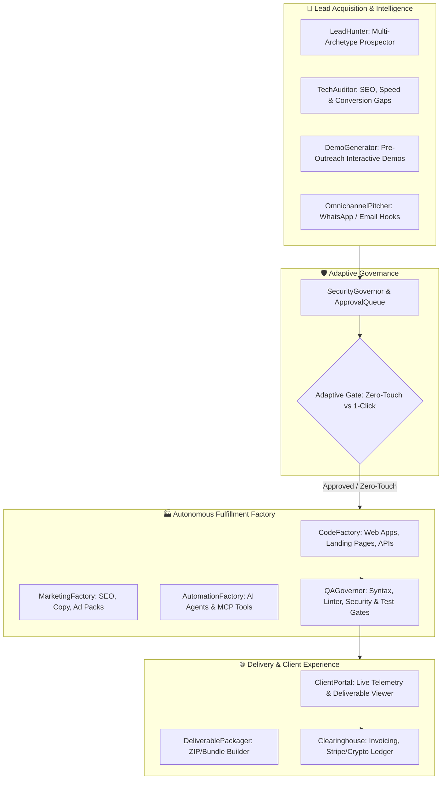

# Autonomous Client Acquisition & Fulfillment Factory (CASHFLOW INFINITY: OMNIVERSE)
**System Specification & Architecture Design**  
*Date: 2026-11-04 | Status: APPROVED | Target: CASHFLOW INFINITY OMNIVERSE OS*

---

## 1. Executive Summary & Vision

The **Autonomous Client Acquisition & Fulfillment Factory** is an institutional-grade, multi-vertical commercial operating system embedded directly into `CASHFLOW INFINITY: OMNIVERSE`. Its mission is to completely automate the entire agency and digital services lifecycle:
1. **Autonomous Lead Acquisition**: Continuous discovery of high-value prospects across multiple market archetypes (Local SMBs, SaaS startups, e-commerce brands, digital agencies).
2. **AI-Powered Deep Audits & Instant Demos**: Autonomous generation of technical, conversion, and SEO gap analysis paired with live demo deliverables before the outreach is sent.
3. **Omnichannel Deal Closing**: Dynamic cold outreach copywriting and 1-click WhatsApp/email/telegram hooks tailored to identified gaps.
4. **Autonomous Fulfillment Factory ("Do All The Work")**:
   - **Code Factory**: Automated full-stack web apps, high-converting landing pages, and backend APIs.
   - **Marketing Factory**: Autonomous SEO topic clusters, ad creatives, and multi-stage lifecycle copy.
   - **Automation Factory**: Custom AI agents, MCP tool connectors, and operational webhook bots.
5. **Quality & Security Governor**: Deterministic pre-flight checks (linting, test execution, security scans, copy validation) before any deliverable is surfaced to a client.
6. **Client Portal & Reconciled Settlement**: Branded interactive client workspace with live order telemetry, deliverable package downloads (ZIP/TAR/JSON), automated invoicing, and verified payment clearing into the OMNIVERSE financial ledger.

---

## 2. Architectural Topology

---

## 3. Core Component Specifications

### 3.1 Data Models (`src/omniverse/modules/agency/models.py`)
- `ProspectArchetype`: `LOCAL_SMB`, `SAAS_STARTUP`, `ECOMMERCE`, `ENTERPRISE`.
- `Lead`: ID, business name, archetype, website, contact email/phone, revenue estimate, status (`DISCOVERED`, `AUDITED`, `PITCHED`, `CONVERTED`, `CLOSED`).
- `AuditReport`: Performance score (0-100), SEO score (0-100), conversion vulnerabilities, speed metrics, estimated monthly revenue loss.
- `JobOrder`: ID, client_id, service_type (`FULLSTACK_DEV`, `MARKETING_SUITE`, `AGENT_AUTOMATION`, `FULL_TRANSFORMATION`), budget_usd, status (`QUEUED`, `BUILDING`, `QA_VERIFIED`, `DELIVERED`, `PAID`).
- `Deliverable`: Artifact ID, name, file_path, artifact_type, checksum, size_bytes, preview_url.
- `ClientAccount`: ID, access_token, name, email, company, active_orders, lifetime_spend_usd.

### 3.2 Lead Acquisition & Audit Engine (`src/omniverse/modules/agency/acquisition.py`)
- `LeadHunter`: Discovers prospects across sectors using synthetic or configured data feeds with rich business metadata.
- `TechAuditor`: Inspects digital footprints and evaluates:
  - Page load latency and mobile responsiveness simulation.
  - Conversion bottlenecks (missing CTAs, lack of instant chat/WhatsApp, poor value prop).
  - SEO gaps (missing meta tags, schema markup, thin content clusters).
- `PersonalizedPitchGenerator`: Assembles tailored pitches highlighting exact lost revenue, accompanied by an instant 1-click action plan and demo preview link.

### 3.3 Autonomous Fulfillment Factory (`src/omniverse/modules/agency/fulfillment/`)
- `CodeFactory` (`code_factory.py`):
  - Generates standalone, modern single-page applications, responsive marketing landing pages, and REST API microservices.
  - Generates production-ready HTML5/Tailwind/React/Vite setups and FastAPI backends.
  - Compiles deliverables into clean, exportable file trees.
- `MarketingFactory` (`marketing_factory.py`):
  - Writes comprehensive conversion-focused sales pages, high-CTR ad variants, and 5-stage customer email onboarding drips.
  - Assembles structured programmatic SEO topic clusters and Schema.org rich snippet JSON-LD payloads.
- `AutomationFactory` (`automation_factory.py`):
  - Scaffolds autonomous AI agents with typed tools, system prompts, and MCP tool schemas.
  - Generates webhook dispatcher bots (Telegram/Discord/WhatsApp notification bridges).

### 3.4 QA & Verification Governor (`src/omniverse/modules/agency/qa_governor.py`)
- Executes automated pre-delivery audits:
  - Code syntax and compilation check (`ast.parse` / HTML validator / JSON schema verification).
  - Security audit (checks for exposed API keys, dangerous scripts, eval patterns).
  - Quality score computation (minimum threshold required before client delivery).

### 3.5 Client Portal & Settlement Engine (`src/omniverse/modules/agency/portal_engine.py`)
- Generates secure, unguessable client access tokens.
- Packages all generated deliverables into organized archive bundles (ZIP/tar) with a README and implementation guide.
- Creates invoices and reconciles collected revenue with `omniverse.modules.settlement.clearing.Clearinghouse`.

---

## 4. API Endpoints & Interfaces

### 4.1 FastAPI Agency Router (`src/omniverse/api/routes/agency.py`)
- `GET /api/v1/agency/overview`: High-level metrics (leads discovered, active jobs, completed deliverables, total revenue).
- `POST /api/v1/agency/hunt`: Trigger autonomous lead generation across target archetypes.
- `POST /api/v1/agency/audit`: Run automated deep tech/growth audit on a target lead.
- `POST /api/v1/agency/pitch`: Draft tailored personalized outreach pitches and demo packages.
- `POST /api/v1/agency/orders`: Create and dispatch a new fulfillment job order.
- `POST /api/v1/agency/orders/{order_id}/execute`: Trigger autonomous agent fulfillment.
- `GET /api/v1/agency/orders/{order_id}/deliverables`: Fetch and download verified deliverables.
- `GET /api/v1/agency/portal/{token}`: Authenticated client portal payload (status, live progress, files).
- `POST /api/v1/agency/portal/{token}/pay`: Simulate or settle invoice payment, recording to reconciled ledger.

### 4.2 Web UI & Client Experience
- Executive Agency Cockpit (`/agency`): Visual dashboard showing live lead pipeline, agent worker pods, pending approvals, and ledger.
- Self-Serve Client Portal (`/portal`): Minimalist, cyberpunk/modern client view showing their project roadmap, code/copy previews, and 1-click download button.

### 4.3 CLI Integration (`src/omniverse/cli.py`)
- `python -m omniverse.cli agency-hunt`
- `python -m omniverse.cli agency-audit <target>`
- `python -m omniverse.cli agency-fulfill <order_id>`
- `python -m omniverse.cli agency-status`

---

## 5. Security & Operational Guarantees

1. **Air-Gapped Safety Integration**: High-ticket client communication and external money moves are routed through `SecurityGovernor` with an auditable cryptographic sign-off queue.
2. **Deterministic Ledger Reconciliation**: Unpaid orders are marked as `Pipeline Value`. Only settled invoices update the `Collected Revenue` ledger in the OMNIVERSE core database.
3. **Zero Fake Deliverables**: Every code artifact created by `CodeFactory` must pass `QAGovernor` syntax validation before status can transition to `QA_VERIFIED`.

---

## 6. Verification & Test Plan

1. **Unit Tests**:
   - `tests/test_agency_models.py`: Model validation, serialization, state transitions.
   - `tests/test_agency_acquisition.py`: Lead hunting, auditing, personalized pitch creation.
   - `tests/test_agency_fulfillment.py`: CodeFactory, MarketingFactory, AutomationFactory execution.
   - `tests/test_agency_qa_governor.py`: Quality gating, syntax validation, security scans.
   - `tests/test_agency_portal.py`: Client token authentication, order fulfillment bundling, payment clearing.
2. **Integration & API Tests**:
   - `tests/test_agency_api.py`: FastAPI routes, end-to-end lead-to-deliverable-to-payment cycle.
3. **Regression Test**:
   - Full test suite run (`pytest -v`) ensuring all existing 116 tests pass with 0 errors.
