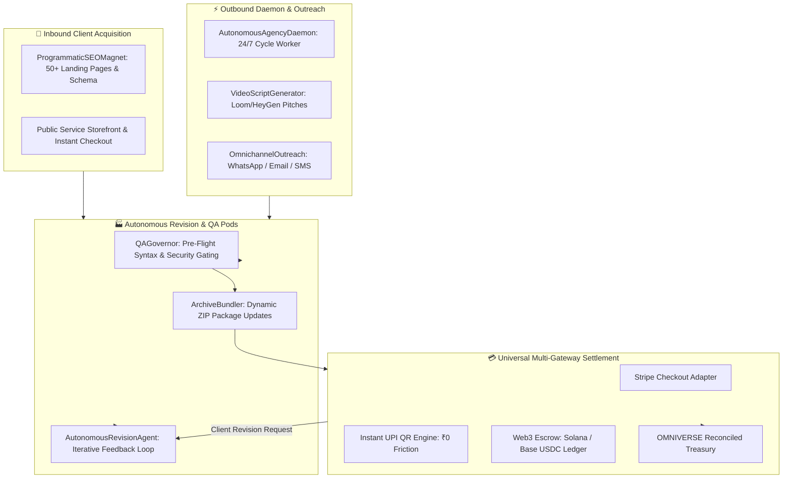

# Autonomous Agency Planetary Scale & Revenue Multiplier
**System Specification & Architecture Design — Phase 2**  
*Date: 2026-11-07 | Status: APPROVED | Target: CASHFLOW INFINITY OMNIVERSE OS*

---

## 1. Executive Summary & Vision

Phase 2 scales the **Autonomous Agency Operating Engine** into a self-sustaining, planetary revenue conglomerate. It introduces:
1. **24/7 Autonomous Daemon & Multi-Channel Outreach Dispatcher**: Continuous background execution loop scanning hundreds of prospects, generating customized video pitch scripts, and staging/dispatching outreach across WhatsApp, Email, and Telegram.
2. **Universal Multi-Gateway Settlement (Fiat + UPI + Web3 Crypto Escrow)**: Instant Indian UPI QR code generation, Stripe Checkout integration, and on-chain Solana/Base USDC escrow verification for borderless, zero-friction client payments.
3. **Inbound Programmatic SEO Magnet**: Programmatic generator building high-converting landing pages targeting competitor alternatives and localized service terms (`[Service] in [City]`) to drive passive, organic inbound clients.
4. **Autonomous Client Revision & Self-Healing Agent**: Client portal feedback ingestion allowing clients to request edits, with an autonomous agent pod refactoring code/copy, re-validating through `QAGovernor`, and updating deliverable packages with zero human labor.

---

## 2. Architectural Topology

---

## 3. Subsystem Specifications

### 3.1 24/7 Autonomous Daemon & Outreach Dispatcher (`outreach.py` & `daemon.py`)
- `AutonomousAgencyDaemon`:
  - Executes periodic cycles: Hunts qualified prospects across archetypes, generates technical audits, crafts pitches with personalized video scripts, and records outreach telemetry.
  - Cycle summary reporting: prospects discovered, pitches queued, delivery jobs completed, revenue collected.
- `OmnichannelOutreachDispatcher`:
  - Dispatches customized email templates (Resend/SendGrid webhook payloads).
  - Generates 60-second video audit scripts (hook, screen walk-through of revenue leaks, prototype reveal, 1-click booking CTA).
  - Formats direct WhatsApp and Telegram click-to-chat links.

### 3.2 Universal Settlement Engine (`crypto_gateway.py` & `upi_gateway.py`)
- `InstantUPIEngine`:
  - Generates UPI intent strings and dynamic QR codes (`upi://pay?pa={vpa}&pn={name}&am={amount}&cu=INR`).
  - Supports instant Indian SMB & startup payment collection.
- `Web3CryptoEscrow`:
  - Supports USDC on Solana and Base/Ethereum.
  - Generates deterministic client deposit addresses or payment URLs.
  - Simulates/verifies cryptographic transaction hashes (`tx_hash`) before transitioning order status to `PAID`.
- Reconciles all settled amounts into the central OMNIVERSE financial treasury.

### 3.3 Programmatic SEO Inbound Magnet (`inbound_pseo.py`)
- `ProgrammaticSEOMagnet`:
  - Templates for:
    - Competitor Alternative Pages: "Top 5 [Competitor] Alternatives in 2027", "Why [Client Solution] Replaces [Legacy Tool]".
    - Local Commercial Service Pages: "Best [Service] in [Metropolitan Hub]" (Bengaluru, SF, London, Singapore, NYC).
  - Generates clean Markdown/HTML with embedded Schema.org JSON-LD and direct client booking links.

### 3.4 Autonomous Client Revision & Self-Healing Agent (`revision_manager.py`)
- `AutonomousRevisionAgent`:
  - Ingests structured client revision requests from portal (`/api/v1/agency/portal/{token}/revise`).
  - Analyzes requested changes against current deliverables.
  - Applies automated refactoring to code files (`index.html`, `main.py`) or marketing copy (`sales_copy.md`).
  - Re-runs `QAGovernor` to ensure 0 syntax errors and 0 leaked secrets.
  - Updates the order ZIP archive and marks deliverable status as `REVISED_AND_QA_VERIFIED`.

---

## 4. API & Interface Extensions

### 4.1 REST API Routes (`src/omniverse/api/routes/agency.py`)
- `POST /api/v1/agency/daemon/run-cycle`: Triggers 1 or more autonomous operational cycles.
- `POST /api/v1/agency/outreach/dispatch`: Dispatches multi-channel outreach campaigns.
- `POST /api/v1/agency/payments/upi-qr`: Generates dynamic UPI payment string/QR data.
- `POST /api/v1/agency/payments/crypto-escrow`: Initializes a Web3 USDC escrow deposit.
- `POST /api/v1/agency/payments/crypto-verify`: Verifies on-chain transaction hash and credits revenue.
- `POST /api/v1/agency/seo/generate-pages`: Generates programmatic SEO landing page clusters.
- `POST /api/v1/agency/portal/{token}/revise`: Ingests client feedback and triggers autonomous self-healing rework.

### 4.2 CLI Commands (`src/omniverse/cli.py`)
- `python -m omniverse.cli agency-daemon --cycles 3`
- `python -m omniverse.cli agency-payout --order <id> --method crypto/upi/stripe`
- `python -m omniverse.cli agency-pseo --niche "AI Automation" --limit 10`
- `python -m omniverse.cli agency-revise --order <id> --feedback "Add dark mode and fix pricing"`

---

## 5. Verification & Test Plan

1. **Unit Tests**:
   - `tests/test_agency_daemon.py`: Autonomous daemon operational cycles and telemetry.
   - `tests/test_agency_outreach.py`: Multi-channel outreach templates and video pitch script generator.
   - `tests/test_agency_payment_gateways.py`: UPI QR generation and Solana/Base USDC escrow verification.
   - `tests/test_agency_inbound_pseo.py`: Programmatic SEO page generation and Schema.org markup.
   - `tests/test_agency_revisions.py`: Autonomous revision loop, deliverable regeneration, and QA verification.
2. **Integration & API Tests**:
   - `tests/test_agency_phase2_api.py`: FastAPI endpoints for daemon cycles, crypto settlement, and client revisions.
3. **Regression Tests**:
   - Run complete test suite ensuring 100% green pass rate across all 37 existing tests + new Phase 2 test suite.
