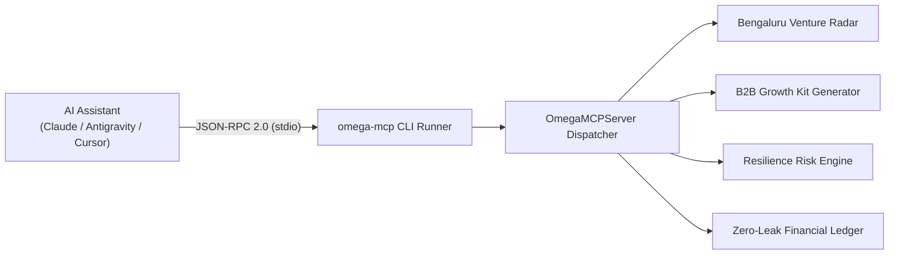

# ⚡ OMEGA-MCP: Autonomous Fleet Hub

[](https://pypi.org/project/omega-mcp/)
[](https://modelcontextprotocol.io/)
[](https://github.com/AdityaMehra007)
[](https://opensource.org/licenses/MIT)

**OMEGA-MCP** is an open-source Model Context Protocol (MCP) tool fleet engineered by **Aditya Mehra**. It provides AI agents (Claude Desktop, Google Antigravity, Cursor, and custom Python harnesses) with real-world tool capabilities for startup telemetry, B2B growth engines, geospatial resilience scoring, and zero-leak financial ledger settlements.

---

## 🚀 Quickstart

### 1. Installation
```bash
pip install omega-mcp
```

### 2. Inspect Available Fleet Tools
```bash
omega-mcp list
```

### 3. Test a Tool Directly from Terminal
```bash
# Query Bengaluru's startup ecosystem
omega-mcp call bengaluru_startup_radar -a '{"query": "Fintech"}'

# Generate an automated B2B growth kit
omega-mcp call generate_growth_kit -a '{"business_name": "Nexora Labs", "niche": "AI Security", "city": "Bengaluru"}'
```

---

## 🔌 Integration with Claude Desktop & Antigravity

Add **OMEGA-MCP** to your `claude_desktop_config.json` or Antigravity MCP settings:

```json
{
  "mcpServers": {
    "omega-fleet": {
      "command": "omega-mcp",
      "args": ["serve"]
    }
  }
}
```

Once connected, your AI assistant can natively invoke:
- `bengaluru_startup_radar`
- `generate_growth_kit`
- `evaluate_resilience_risk`
- `double_entry_ledger_clearing`

---

## 🏗️ Architecture



---

## 📄 License
MIT License. Engineered by [Aditya Mehra](https://github.com/AdityaMehra007).
